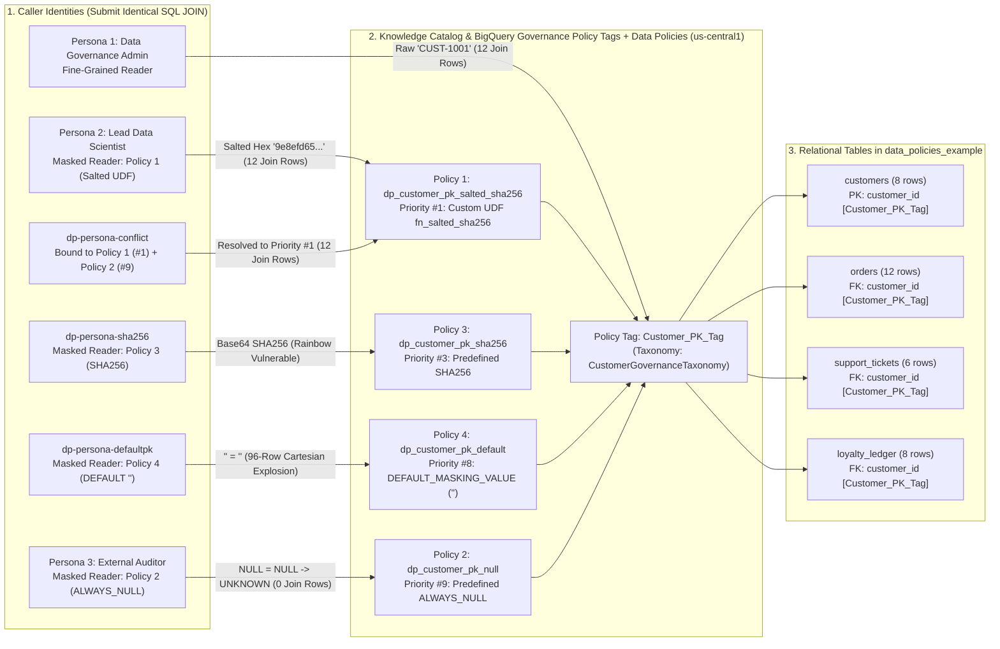
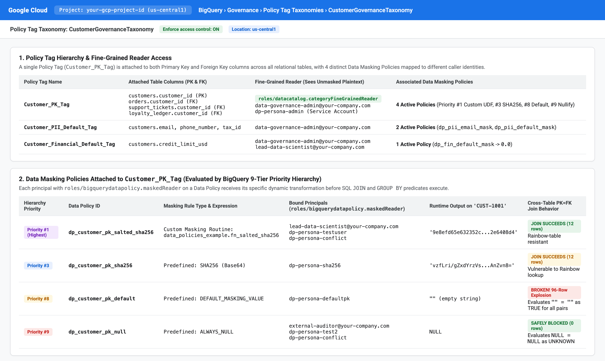
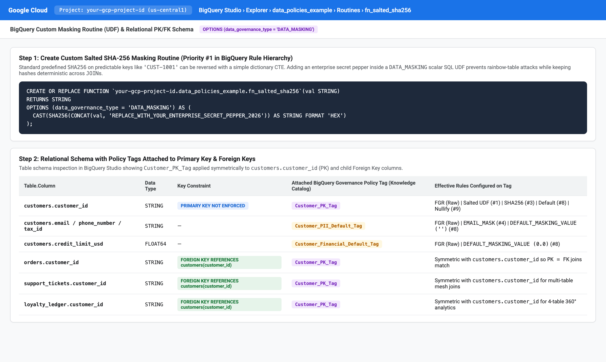
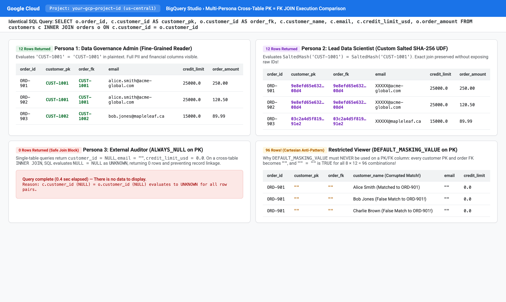
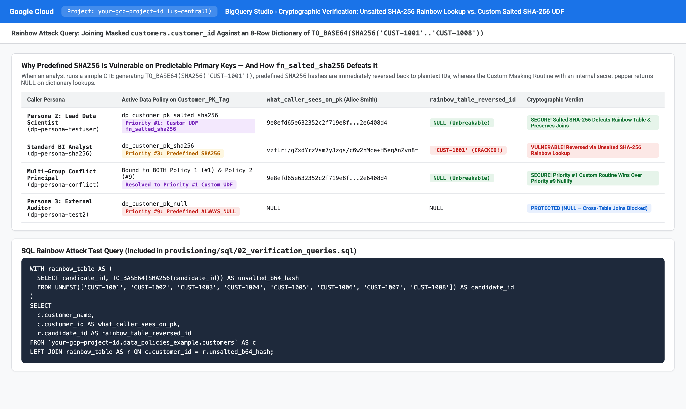
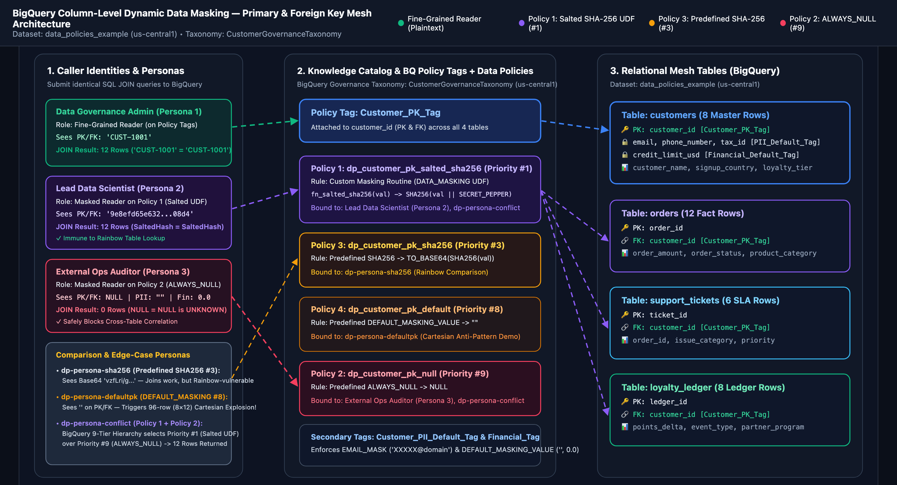

# BigQuery Dynamic Data Masking on Primary & Foreign Keys — Live Demo & Customer Implementation Boilerplate

**Repository:** `https://github.com/gargravish/bq-data-policy-lab`  
**Default Dataset:** `data_policies_example` (`us-central1`) | **Taxonomy:** `CustomerGovernanceTaxonomy`

This repository provides a **self-contained customer implementation guide, automated idempotent provisioning suite, live multi-persona verification harness, and interactive web workbench** demonstrating how multiple **BigQuery Column-Level Dynamic Data Masking Policies** attached to a single **BigQuery Governance Policy Tag (`Customer_PK_Tag`)**—integrated with **Knowledge Catalog (Dataplex)**—behave across relational Primary Key (`PK`) and Foreign Key (`FK`) `JOIN`s.

---

## 1. Access Matrix & Persona Design

All personas execute the **exact same SQL queries** against `data_policies_example` (`customers`, `orders`, `support_tickets`, and `loyalty_ledger`). BigQuery dynamically rewrites column values at query runtime before evaluating `JOIN` or `GROUP BY` predicates:

| Persona / Identity | Role & Policy Assignment | What They See on `customer_id` (PK & FK) | Secondary PII (`email`) & Financial (`credit_limit_usd`) | Cross-Table `JOIN` Capability (`customers ⋈ orders`) | Live Row Count |
| :--- | :--- | :--- | :--- | :--- | :--- |
| **Persona 1: Data Governance Admin**<br/>(`ADMIN_USER_EMAIL` / `dp-persona-admin` SA) | **Fine-Grained Reader** (`roles/datacatalog.categoryFineGrainedReader`) on Policy Tags | Raw plaintext:<br/>`'CUST-1001'` | `'alice.smith@acme-global.com'`<br/>`$25,000.00` | **Yes** — Evaluates `'CUST-1001' = 'CUST-1001'` | **12 rows** (2-table)<br/>**7 rows** (4-table) |
| **Persona 2: Lead Data Scientist**<br/>(`ANALYST_USER_EMAIL` / `dp-persona-testuser` SA) | **BigQuery Masked Reader** (`roles/bigquerydatapolicy.maskedReader`) on **Policy 1 (`dp_customer_pk_salted_sha256`)** — Custom Masking Routine (`fn_salted_sha256`, Priority `#1`) | Salted SHA-256 Hex:<br/>`'9e8efd65e632352c...2e6408d4'` | `'XXXXX@acme-global.com'` (`EMAIL_MASK`)<br/>`$25,000.00` | **Yes** — Evaluates `SaltedSHA256 = SaltedSHA256` across all 4 tables; **immune to rainbow-table reversal** | **12 rows** (2-table)<br/>**7 rows** (4-table) |
| **Persona 3: External Contractor / Auditor**<br/>(`AUDITOR_USER_EMAIL` / `dp-persona-test2` SA) | **BigQuery Masked Reader** on **Policy 2 (`dp_customer_pk_null`, `ALWAYS_NULL`)** on PK + **`DEFAULT_MASKING_VALUE`** on PII/Financial | Obscured:<br/>`NULL` | `""` (empty string)<br/>`0.0` | **No** — Evaluates `NULL = NULL` as `UNKNOWN` in SQL three-valued logic, safely blocking correlation | **0 rows** (2-table)<br/>**0 rows** (4-table) |
| **Comparison Persona: Unsalted SHA-256**<br/>(`dp-persona-sha256` SA) | **BigQuery Masked Reader** on **Policy 3 (`dp_customer_pk_sha256`, Predefined `SHA256`, Priority `#3`)** | Base64 SHA-256:<br/>`'vzfLri/gZxdYrzVs...AnZvn8='` | `'XXXXX@acme-global.com'`<br/>`0.0` | **Yes**, but **vulnerable to Rainbow Table dictionary lookup** on sequential IDs (`'CUST-1001'`) | **12 rows** (2-table)<br/>**7 rows** (4-table) |
| **Anti-Pattern Persona: Default PK Mask**<br/>(`dp-persona-defaultpk` SA) | **BigQuery Masked Reader** on **Policy 4 (`dp_customer_pk_default`, `DEFAULT_MASKING_VALUE`, Priority `#8`)** | Empty string:<br/>`""` | `""`<br/>`0.0` | **Broken (Cartesian Explosion!)** — Evaluates `"" = ""` as `TRUE` for every row pair ($8 \times 12 = 96$ rows) | **96 rows** (2-table)<br/>**384 rows** (4-table) |
| **Multi-Group Conflict Persona**<br/>(`dp-persona-conflict` SA) | Granted `maskedReader` on **BOTH** Policy 1 (`fn_salted_sha256`, Priority `#1`) and Policy 2 (`ALWAYS_NULL`, Priority `#9`) | Salted SHA-256 Hex:<br/>`'9e8efd65e632352c...2e6408d4'` | `'XXXXX@acme-global.com'`<br/>`0.0` | **Yes** — BigQuery's 9-tier rule hierarchy resolves Priority `#1` (`Custom masking routine`) over Priority `#9` (`Nullify`) | **12 rows** (2-table)<br/>**7 rows** (4-table) |

---

## 2. Architecture Diagram



---

## 3. Quickstart: Deploy in Your Google Cloud Environment

### Step 1: Clone the Repository & Configure `.env`

```bash
git clone https://github.com/gargravish/bq-data-policy-lab.git
cd bq-data-policy-lab

# Copy the template environment file and set your GCP Project ID & Persona Emails
cp .env.example .env
```

Edit `.env` with your project details:

```ini
GOOGLE_CLOUD_PROJECT=your-gcp-project-id
BQ_LOCATION=us-central1
BQ_DATASET=data_policies_example
SECRET_PEPPER=REPLACE_WITH_YOUR_ENTERPRISE_SECRET_PEPPER_2026

ADMIN_USER_EMAIL=data-governance-admin@your-company.com
ANALYST_USER_EMAIL=lead-data-scientist@your-company.com
AUDITOR_USER_EMAIL=external-auditor@your-company.com
```

### Step 2: Run the Automated Provisioning & Live Verification Suite

```bash
# Install Python dependencies
pip install -r backend/requirements.txt

# 1. Idempotently provision Taxonomy, 3 Policy Tags, Custom UDF, 7 Data Policies, 4 PK/FK Tables, and IAM Bindings
python3 provisioning/provision_all.py

# 2. Execute live impersonated BigQuery queries across all 6 personas (24 assertions)
python3 provisioning/verify_live_personas.py
```

### Step 3: Launch the Interactive Web Workbench (`127.0.0.1:8088`)

```bash
./start_demo.sh
```

Open **`http://127.0.0.1:8088`** in your browser to run side-by-side multi-persona `JOIN` comparisons, inspect the 9-tier masking rule hierarchy, and execute the live Rainbow Table vs. Salted SHA-256 attack lab.

---

## 4. Manual Step-by-Step Implementation Guide (CLI, REST API & GoogleSQL)

### Part 1: Create the BigQuery Dataset & Custom Masking Routine (`fn_salted_sha256`)

```bash
export PROJECT_ID="your-gcp-project-id"
export LOCATION="us-central1"
export DATASET_ID="data_policies_example"

bq --location="${LOCATION}" mk --dataset \
  --description "Live Demo: Multiple Dynamic Data Masking Policies on Primary & Foreign Keys" \
  "${PROJECT_ID}:${DATASET_ID}"
```

Create the **Custom Masking Routine (`fn_salted_sha256`)** with `OPTIONS (data_governance_type = 'DATA_MASKING')`:

```sql
CREATE OR REPLACE FUNCTION `YOUR_PROJECT_ID.data_policies_example.fn_salted_sha256`(val STRING)
RETURNS STRING
OPTIONS (data_governance_type = 'DATA_MASKING') AS (
  CAST(SHA256(CONCAT(val, 'REPLACE_WITH_YOUR_ENTERPRISE_SECRET_PEPPER_2026')) AS STRING FORMAT 'HEX')
);
```

> **Why Custom Salted SHA-256 instead of Predefined `SHA256`?**
> Predefined `SHA256` computes an unsalted hash (`TO_BASE64(SHA256('CUST-1001'))` = `'vzfLri/gZxdYrzVsm7yJzqs/c6w2hMce+H5eqAnZvn8='`). Because primary keys like `'CUST-1001'` follow a known sequential pattern, any analyst can generate a dictionary CTE of `SHA256('CUST-1001'..'CUST-9999')` and join it against the masked column to reverse every ID. By embedding an enterprise secret pepper inside `fn_salted_sha256`, authorized data scientists receive deterministic hashes that join seamlessly across `customers`, `orders`, `support_tickets`, and `loyalty_ledger` while defeating rainbow-table lookups.

### Part 2: Create BigQuery Governance Policy Tag Taxonomy (Knowledge Catalog) & BigQuery Data Policies

> **Important Note on Current Google Cloud Naming vs. Underlying REST/IAM Identifiers:**
> Standalone **Google Cloud Data Catalog** is deprecated and replaced by **Knowledge Catalog** (formerly *Dataplex Universal Catalog*, managed via `dataplex.googleapis.com/v1`). In the Google Cloud Console, Policy Tag Taxonomies and Data Policies are managed under **`BigQuery > Governance > Policy tags`** (`https://console.cloud.google.com/bigquery/security/secure/policy-tags`).
> Under the hood, Google Cloud retains the `datacatalog.googleapis.com/v1` service endpoint (`taxonomies` and `policyTags`) and the `roles/datacatalog.categoryAdmin` / `roles/datacatalog.categoryFineGrainedReader` IAM role strings specifically for Policy Tag Taxonomies, while **BigQuery Data Policies** use `bigquerydatapolicy.googleapis.com` (`v1` for policy-tag-bound policies, or `v2` / `CREATE DATA_POLICY` DDL for Resource Manager Data Governance Tags and direct column data policies).

```bash
TOKEN=$(gcloud auth print-access-token)

# 1. Create BigQuery Governance Policy Tag Taxonomy with FINE_GRAINED_ACCESS_CONTROL
curl -s -X POST \
  -H "Authorization: Bearer ${TOKEN}" \
  -H "Content-Type: application/json" \
  "https://datacatalog.googleapis.com/v1/projects/${PROJECT_ID}/locations/${LOCATION}/taxonomies" \
  -d '{
    "displayName": "CustomerGovernanceTaxonomy",
    "description": "Enterprise Fine-Grained Access Control & Multi-Policy Dynamic Data Masking Taxonomy",
    "activatedPolicyTypes": ["FINE_GRAINED_ACCESS_CONTROL"]
  }'

# 2. Create Policy Tag Customer_PK_Tag under the Taxonomy
# Set PK_TAG to the returned policyTag resource name:
# export PK_TAG="projects/${PROJECT_ID}/locations/${LOCATION}/taxonomies/<TAXONOMY_ID>/policyTags/<TAG_ID>"

# 3. Create Data Policy 1: Custom Masking Routine (Salted SHA-256, Priority #1)
curl -s -X POST \
  -H "Authorization: Bearer ${TOKEN}" \
  -H "Content-Type: application/json" \
  "https://bigquerydatapolicy.googleapis.com/v1/projects/${PROJECT_ID}/locations/${LOCATION}/dataPolicies" \
  -d "{
    \"dataPolicyId\": \"dp_customer_pk_salted_sha256\",
    \"dataPolicyType\": \"DATA_MASKING_POLICY\",
    \"policyTag\": \"${PK_TAG}\",
    \"dataMaskingPolicy\": {
      \"routine\": \"projects/${PROJECT_ID}/datasets/${DATASET_ID}/routines/fn_salted_sha256\"
    }
  }"

# 4. Create Data Policy 2: Nullify (ALWAYS_NULL, Priority #9)
curl -s -X POST \
  -H "Authorization: Bearer ${TOKEN}" \
  -H "Content-Type: application/json" \
  "https://bigquerydatapolicy.googleapis.com/v1/projects/${PROJECT_ID}/locations/${LOCATION}/dataPolicies" \
  -d "{
    \"dataPolicyId\": \"dp_customer_pk_null\",
    \"dataPolicyType\": \"DATA_MASKING_POLICY\",
    \"policyTag\": \"${PK_TAG}\",
    \"dataMaskingPolicy\": {
      \"predefinedExpression\": \"ALWAYS_NULL\"
    }
  }"
```

### Part 3: Create Relational PK/FK Tables & Attach Policy Tags

Execute [`provisioning/sql/01_schema_and_udf.sql`](provisioning/sql/01_schema_and_udf.sql) to create `customers`, `orders`, `support_tickets`, and `loyalty_ledger` with `PRIMARY KEY (...) NOT ENFORCED` and `FOREIGN KEY (customer_id) REFERENCES customers(customer_id) NOT ENFORCED`, and attach `Customer_PK_Tag` to `customer_id` across all four tables.

### Part 4: Run Multi-Persona Verification Queries

Execute [`provisioning/sql/02_verification_queries.sql`](provisioning/sql/02_verification_queries.sql) across the personas to verify:
1. **Single-Table Inspection** (`customers`)
2. **2-Table PK=FK Join** (`customers` ⋈ `orders` ON `c.customer_id = o.customer_id`)
3. **4-Table Enterprise 360° Mesh Join** (`customers` ⋈ `orders` ⋈ `support_tickets` ⋈ `loyalty_ledger`)
4. **Customer Spend Aggregation** (`GROUP BY c.customer_id`)
5. **Cryptographic Rainbow Table Attack Lab** (proving `fn_salted_sha256` resists dictionary reversal while predefined `SHA256` is reversed).

---

## 5. BigQuery Console Visual Walkthrough

### 1. Policy Tag Taxonomy & Data Masking Policies (`CustomerGovernanceTaxonomy`)


### 2. Custom Salted SHA-256 Masking Routine (`fn_salted_sha256`) & PK/FK Table Schema


### 3. Multi-Persona Cross-Table `PK = FK JOIN` Execution Results


### 4. Cryptographic Verification: Unsalted SHA-256 Rainbow Lookup vs. Salted UDF


### 5. Interactive Architecture Blueprint


---

## 6. Repository Structure

```text
bq-data-policy-lab/
├── .env.example                        # Customer configuration template (copy to .env)
├── .gitignore                          # Excludes .env and local provisioning state
├── README.md                           # Self-contained customer implementation guide
├── start_demo.sh                       # One-command launcher for local FastAPI + Web Workbench
├── provisioning/
│   ├── provision_all.py                # Idempotent end-to-end GCP provisioning script
│   ├── verify_live_personas.py         # 6-persona, 24-assertion live BigQuery verification suite
│   └── sql/
│       ├── 01_schema_and_udf.sql       # Standalone DDL for UDF & 4 relational PK/FK tables
│       └── 02_verification_queries.sql # Standalone multi-persona JOIN & Rainbow Lab queries
├── backend/
│   ├── requirements.txt                # Python dependencies
│   └── app/
│       └── main.py                     # FastAPI live impersonation query engine
└── frontend/
    └── dist/
        ├── index.html                  # Executive Web Workbench UI
        ├── styles.css                  # Responsive dark/light theme styles
        ├── app.js                      # Safe DOM client for multi-persona BigQuery comparison
        └── architecture-map.html       # Standalone interactive SVG architecture diagram
```
